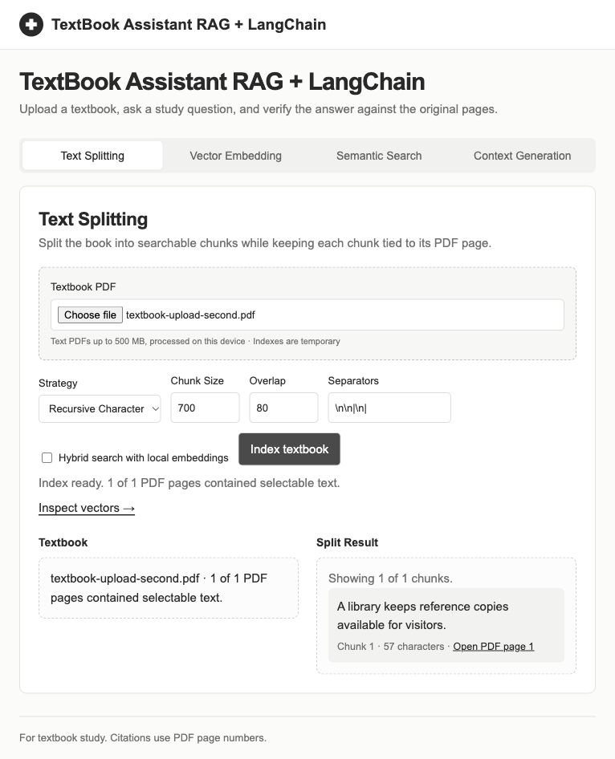
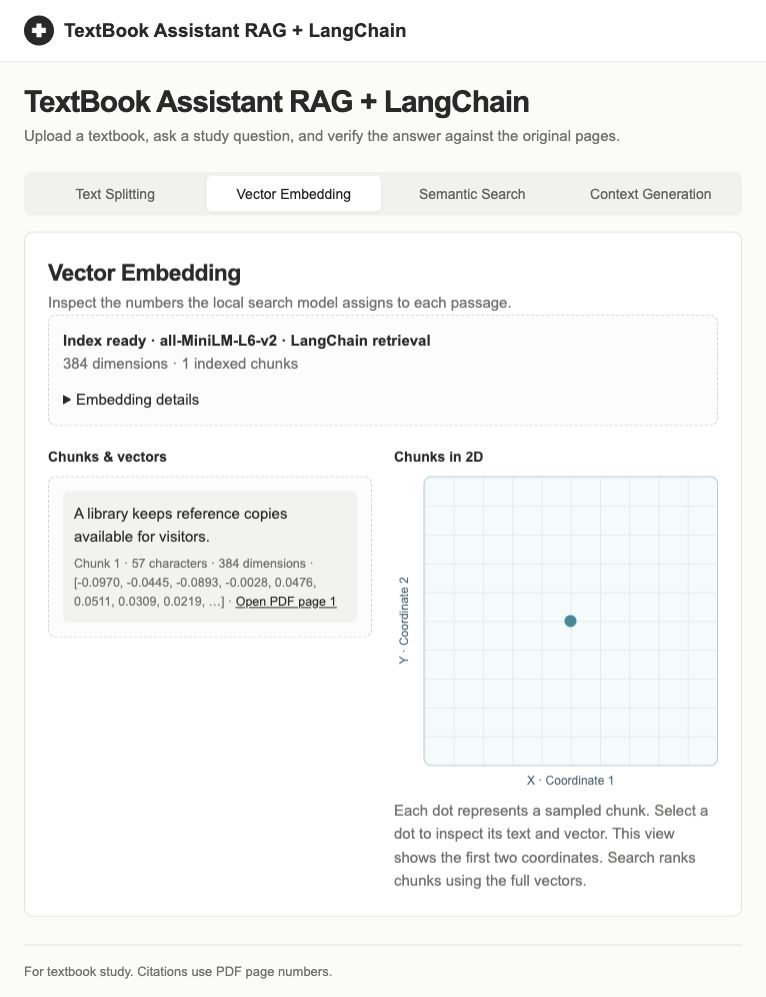
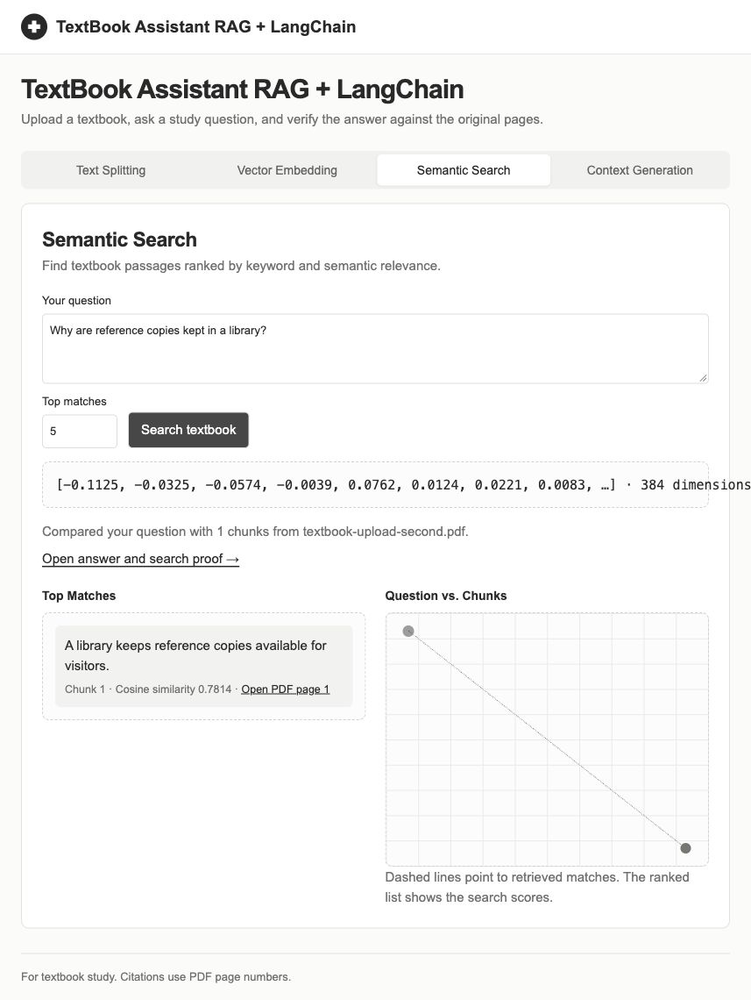
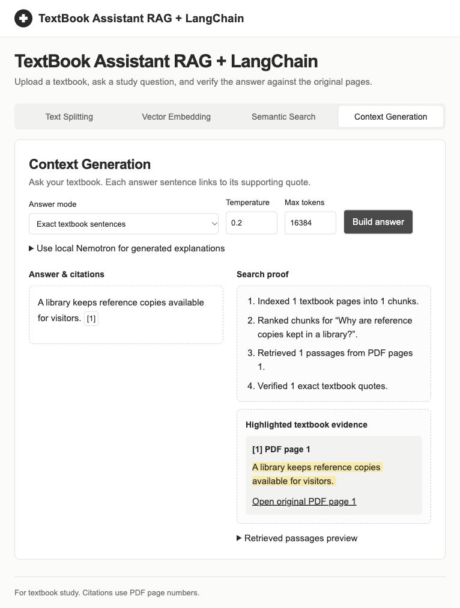
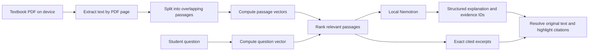
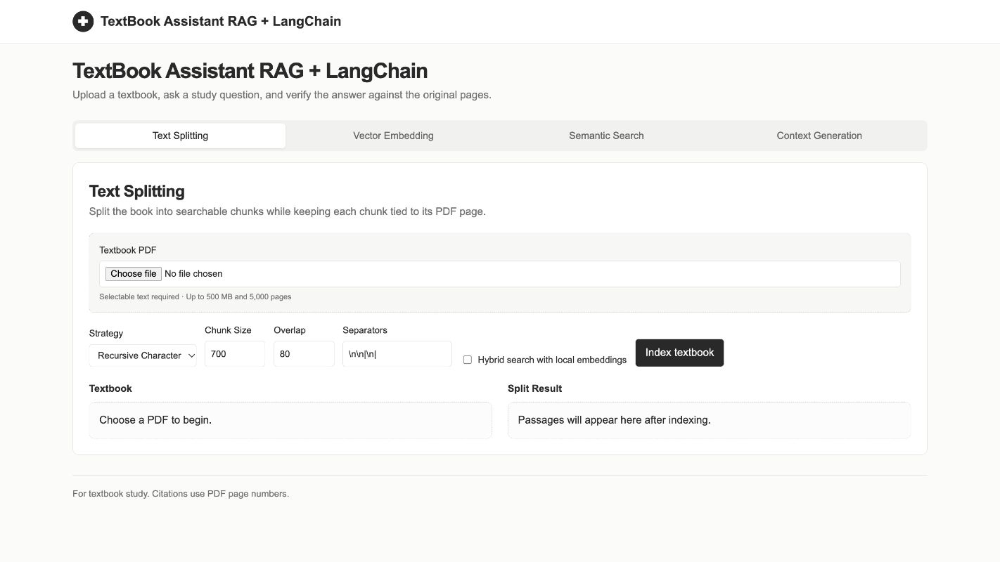

# TextBook Assistant RAG + LangChain

A textbook study application that makes retrieval visible. Students select a text-based PDF, inspect its passages and embedding vectors, ask questions, and read answers with links to the supporting text and original PDF pages.

The application focuses on medical textbooks, but its retrieval pipeline accepts other English-language textbooks with selectable text.

**[Open the application](https://textbook-assistant-rag-langchain.vercel.app/)** · **[Source repository](https://github.com/Gayatri2502/textbook-assistant-rag-langchain)**

## First, what are RAG and LangChain?

### RAG — Retrieval-Augmented Generation

RAG is a method for answering questions using reference material supplied at question time. In this project, that reference material is the student's textbook.

The method has three connected operations:

1. **Retrieve** relevant passages from the indexed book.
2. **Augment** the model's input with those passages and the student's question.
3. **Generate** an explanation using that evidence, with references back to the source.

For example, suppose a book says that reference copies stay in a library so visitors can consult them. A student asks why the library keeps those copies. Retrieval selects that passage, the answer prompt includes it, and generation explains its purpose. The student can then check the cited passage.

Indexing prepares the book before a question is asked. It extracts text, splits it into chunks, and converts chunks into numerical representations called embeddings. At search time, the same embedding model converts the question into a vector. Comparing question and passage vectors helps find related wording.

The generative model's weights remain unchanged during this workflow. The textbook is provided as answer context. This makes the approach suitable for adding a new book without fine-tuning a language model.

The **Exact textbook sentences** option exposes retrieval results as an extractive answer. The full RAG generation path runs when **Generated explanation** sends the retrieved evidence to Nemotron.

### LangChain — orchestration around model and retrieval operations

LangChain is a framework for composing operations such as retrieval, prompt construction, and model calls into callable workflows. A runnable accepts an input, performs an operation, and returns an output.

In this project's browser implementation, a bundled LangChain Core `RunnableLambda` receives the question and match limit. Its implementation:

1. Encodes the question with MiniLM.
2. Compares the question vector with the indexed chunk vectors.
3. Optionally combines semantic similarity with keyword overlap.
4. Returns ranked passages, scores, vector previews, and source metadata.

The application calls that runnable through `invoke`. The surrounding PDF processing, answer prompt, Ollama request, evidence validation, and interface are implemented directly in application code.

### How RAG and LangChain work together here

| Concept | Implementation |
| --- | --- |
| Knowledge source | Student-selected textbook PDF |
| Index preparation | PDF extraction, page-aware chunking, passage embeddings |
| Retriever | LangChain runnable wrapping in-memory similarity ranking in the browser |
| Retrieved context | Highest-ranked child passages or their parent context |
| Answer prompt | Study-answer instructions plus the question and numbered evidence |
| Generator | Local Ollama running `nemotron-3-nano:4b` |
| Citation resolver | Application maps selected evidence IDs to exact original text and PDF pages |
| Evidence interface | Highlighted source cards and original-page links |

The browser uses an in-memory vector collection. No Pinecone account or hosted vector database is required. The Python implementation has its own local indexing and retrieval path, documented below.

## Screenshot walkthrough

These are actual screenshots of the hosted application, captured with a small, synthetic one-page library-policy PDF. The example keeps the evidence easy to inspect and avoids reproducing textbook content. It demonstrates the interface and data flow. The final screenshot shows **extractive mode**.

### 1. Text Splitting — prepare the source



Select a PDF and configure the strategy, chunk size, overlap, separators, and hybrid setting. The result shows extracted chunks with character counts and page links. Page provenance is retained as the text is prepared for retrieval.

In the screenshot, the source fits in one chunk. Larger books produce many chunks. The application reports extraction and embedding progress as separate processing stages.

### 2. Vector Embedding — inspect the index



This page displays the active model, full dimension count, sampled chunk text, character counts, and the first eight coordinates of each vector. The screenshot shows a computed **384-dimensional** MiniLM embedding.

The dot in the right-hand grid corresponds to the example chunk. X and Y show its first two coordinates. Selecting the point focuses the matching chunk card. The full vector is used for retrieval, while the plotted pair provides an inspectable preview.

### 3. Semantic Search — find question-relevant evidence



Enter a question and the number of matches to retrieve. The page displays the question vector preview, dimension count, ranked results, similarity scores, and the relationship between the question and selected chunks.

In this example, the question uses different wording from the source. The retrieved passage appears with its score and a PDF page link. The plot connects the question point with the passage point.

### 4. Context Generation — answer and check the evidence



This page assembles the answer and displays the evidence beside it. Inline citation buttons focus the corresponding highlighted passage. Original PDF links let the student inspect the source page.

The screenshot uses **Exact textbook sentences**, so the displayed answer is a direct excerpt. For a structured explanation, use **Check local setup** to enable Nemotron, then select **Generated explanation**.

The generated path supplies evidence IDs to the model, resolves the returned IDs back to source passages, and renders the title, sections, answer points, and citations. Temperature and maximum tokens affect generation. The search-proof panel records the retrieval and citation steps.

## What a student does

1. Open **Text Splitting**, select a PDF, and choose the passage size, overlap, and splitting strategy.
2. Select **Index textbook**. Wait for PDF extraction and then embedding computation to finish.
3. Open **Vector Embedding** to inspect sampled passages, character counts, dimensions, and vector coordinates.
4. Open **Semantic Search**, enter a question, and inspect the highest-ranked passages.
5. Open **Context Generation**. Choose exact excerpts or enable local Nemotron to generate an explanation.
6. Follow an inline citation to its highlighted source text. Open the original PDF at that page to check the surrounding material.

A book must be indexed again after changing its splitting or hybrid-search settings.

## Two execution paths

The hosted website and the local Python application use different implementations. Their outputs should be evaluated with the relevant path recorded.

| Property | Hosted website | Local Python application |
| --- | --- | --- |
| PDF extraction | PDF.js in the browser | pypdf on the local server |
| Textbook location | Student's browser memory | Local disk |
| Semantic representation | MiniLM embeddings through Transformers.js | TF-IDF and latent semantic analysis, with optional Ollama embeddings |
| Retrieval orchestration | LangChain RunnableLambda | Python search implementation |
| Generated explanation | Browser requests local Ollama after an explicit setup check | Python server requests local Ollama |
| Persistence | Current browser tab | Saved PDFs and indexes in `.textbooks/` |
| Cloud model requirement | None | None |

The Python package directory retains the historical name `travel_assistant` so existing launch commands remain valid.

## Architecture



The hosted browser runs extraction, embedding, and retrieval on the student's device. Vercel serves the application and its JavaScript assets. Generated answers use the student's own Ollama installation.

### What LangChain does

The browser wraps query embedding and passage ranking in a bundled LangChain `RunnableLambda`. Calling `invoke` runs the retrieval operation. LangChain is served with the app rather than dynamically fetched from esm.sh.

PDF extraction, splitting, the in-memory vector collection, citation resolution, and rendering are application code. The local Python retrieval implementation is independent of the JavaScript runnable.

## Methodology

### 1. Extract text with page provenance

Each passage retains the source PDF page number. A citation refers to the one-based PDF page index, which can differ from the printed page number because of covers and front matter.

PDFs need selectable text. Scanned pages need OCR before indexing. Embedded figures and tables are subject to the quality of PDF text extraction. The application does not perform diagram interpretation or OCR.

### 2. Split pages into passages

Defaults are **700 characters per chunk** and **80 characters of overlap**. These settings count characters. The overlap repeats the end of one chunk at the start of the next so evidence near a boundary is less likely to be separated completely.

| Strategy | Current behavior |
| --- | --- |
| Fixed Character | Splits at the character limit |
| Recursive Character | Prefers configured separators near the limit, then uses the character boundary if necessary |
| Parent–Child | Embeds and searches smaller child chunks, then supplies larger parent text from the same page as answer context |

Default separators are a paragraph break, a line break, and a space. The UI represents them as `\n\n|\n| `.

Splitting stays within each PDF page. Parent regions use blocks approximately three times the child size and extend as needed to include the matched child. Parent results are deduplicated after selecting child matches, so fewer results than the requested count can appear.

### 3. Compute embeddings

**Browser pipeline**

- Model — `Xenova/all-MiniLM-L6-v2`.
- Runtime — Transformers.js.
- Representation — mean-pooled, normalized vectors, normally 384 dimensions.
- Acceleration — tries WebGPU with FP32, then falls back to quantized Q8 WebAssembly.
- Indexing — batches of 16 passages.
- Storage — passage vectors remain in the active tab.

The question uses the same encoder and normalization as the passages. The displayed dimension count is derived from the computed vector length.

“Embedding chunks 288 / 3177” means PDF extraction and splitting have completed and 288 passages have been encoded. The initial model download and thousands of CPU inference operations can take time.

**Local Python pipeline**

The default index uses TF-IDF unigrams and bigrams, English stop-word removal, and up to 60,000 features. When the matrix is large enough, truncated SVD produces up to 64 latent dimensions, followed by normalization.

Optional hybrid indexing uses Ollama `all-minilm` to compute dense embeddings in batches of 128.

### 4. Retrieve relevant passages

**Browser semantic search**

For normalized vectors, cosine similarity is their dot product.

```text
semantic_score = sum(chunk_vector[i] × question_vector[i])
```

With browser hybrid search selected, the app combines semantic similarity and query-term overlap.

```text
hybrid_score = 0.8 × cosine_similarity + 0.2 × query_term_coverage
```

The lexical component uses lowercased alphabetic terms of at least three characters. All indexed chunks are scored, sorted, and reduced to the requested top matches.

**Local Python search**

The default combines TF-IDF similarity and latent similarity when available. With Ollama embeddings enabled, reciprocal rank fusion combines the keyword and dense rankings, using up to 100 candidates from each list and a rank constant of 60.

Scores express ranking relevance. They do not measure the probability that an answer is correct.

### 5. Generate an answer

The app provides two answer modes.

**Exact textbook sentences**

The hosted path displays retrieved excerpts with citations. The Python path selects relevant complete sentences using query-term overlap. This mode works without a generative model.

**Generated explanation**

The configured model is **`nemotron-3-nano:4b`**, running in local Ollama.

The browser assigns evidence IDs to sentence spans before generation. Its JSON schema requires the model to return the title and structured answer points, with each point referring to an allowed evidence ID. The app resolves that ID back to the original passage, page, and character offset.

The answer-sheet prompt requests:

- An uppercase title with a double underline.
- A direct, unheaded opening.
- Descriptive underlined section headings.
- Short explanatory points with optional lead-in labels.
- An arrow sequence when the source describes an actual sequence.
- Concise closing takeaways.

The Python answer endpoint uses source IDs and sentence ranges, validates quotes, and performs an additional model-based support check. Its answer formatting and fallback behavior can differ from the browser implementation.

Default controls are **temperature 0.2** and **maximum output 16,384 tokens**. The browser requests a 32,768-token context window. The Python path requests up to 49,152 context tokens for larger output budgets. A large token budget is an output ceiling. It does not guarantee a particular answer length.

### 6. Inspect source evidence

An inline citation focuses the corresponding evidence card. The original quoted text is highlighted, with a link to the PDF page. Generated explanations and quoted evidence appear separately.

Browser citation validation establishes that the referenced evidence exists in the uploaded text. It does not independently establish that every generated statement follows from that evidence. Students and evaluators should assess support by reading the highlighted passage.

## Understanding the graphs

- Each dot represents a chunk.
- The embedding plot shows a sample of up to approximately 120 chunks.
- X and Y are the **first two vector coordinates**.
- The search plot shows retrieved chunks and the question, with connecting lines.
- Clicking a chunk dot selects its source card.
- Vector cards show the first eight coordinates and the full dimension count.

These are coordinate previews. The application does not apply PCA, UMAP, or t-SNE to produce a semantic map. A visually close pair of dots can have different similarity in the full vector space. Retrieval uses the full vector.

## Free setup

### Use the website

Open the application and select a PDF. The browser downloads PDF.js and the embedding runtime/model as needed. Textbook extraction and semantic search then run on your device.

The application has no paid Blob upload path. The student's PDF is not sent to the Vercel upload endpoint by this browser workflow.

A device still needs sufficient memory, disk cache space, and compute. Internet data, electricity, and hosting-plan allowances remain external costs. A 500 MB selection limit is not a guarantee that every 500 MB book can be processed on every device.

### Enable generated explanations on the website

Install Ollama, then download Nemotron:

```bash
ollama pull nemotron-3-nano:4b
```

Allow the website origin when starting Ollama:

```bash
OLLAMA_ORIGINS=https://textbook-assistant-rag-langchain.vercel.app ollama serve
```

For the macOS Ollama application, set the environment variable and restart Ollama:

```bash
launchctl setenv OLLAMA_ORIGINS "https://textbook-assistant-rag-langchain.vercel.app"
```

Use **Context Generation → Use local Nemotron → Check local setup**. The check verifies that Ollama is reachable and the model is installed. Approve local-network access if requested by the browser.

Questions and matched textbook passages are sent to Ollama on `127.0.0.1:11434`. The model runs on that device. Compatibility depends on browser local-network permissions and Ollama origin configuration.

### Run the complete local application

Use Python 3.12 or newer:

```bash
git clone https://github.com/Gayatri2502/textbook-assistant-rag-langchain.git
cd textbook-assistant-rag-langchain
PYTHON_BIN=python3.12 ./run.sh
```

Open `http://127.0.0.1:8001/`.

The script creates a virtual environment, installs dependencies, and runs FastAPI with Uvicorn. Alternatively, install `requirements.txt` in your own environment and run:

```bash
python -m uvicorn travel_assistant.app:app --host 127.0.0.1 --port 8001
```

For local hybrid search:

```bash
ollama pull all-minilm
```

Select **Hybrid search with local embeddings** before indexing.

Saved PDFs, index files, and library metadata live in `.textbooks/`. Set `TEXTBOOK_LIBRARY` to use a different local directory. Index files use Python pickle and should be treated as trusted application-generated files. Avoid replacing them with downloaded or untrusted index files.

## Limits and current boundaries

| Area | Current behavior |
| --- | --- |
| PDF selection | Up to 500 MiB, shown as 500 MB in the UI |
| Page limit | 5,000 PDF pages |
| Chunk limit | 100,000 |
| Browser persistence | Index lasts for the active tab |
| Local persistence | PDFs and indexes survive server restarts |
| Local cache | Up to eight recently indexed books remain in the upload-managed memory cache; saved indexes can be reloaded |
| Text extraction | Selectable text; no integrated OCR |
| Retrieval corpus | One active textbook at a time |
| Language | Primarily English |
| Answer engine | Local Nemotron through Ollama |
| Source fidelity | Exact source spans can be highlighted; factual entailment still needs evaluation |
| Hosted Python endpoint | Direct server upload remains limited to 4 MB; website selection uses browser processing instead |

The browser reads the PDF into memory and retains passage text and vectors. Indexing a large file can be slow or exceed device memory. PDF size alone does not predict processing cost.

Browser retrieval returns top-ranked passages even for unrelated questions. It currently has no calibrated relevance threshold. Unanswerable-question behavior must be evaluated through the full retrieval-and-answer workflow.

The browser setup check confirms model availability. The current interface provides status text during generation and renders the completed answer after the response. It does not stream generated tokens.

This is a textbook study tool. Its citation mechanism and model output have not been clinically validated.

## How to judge the application

Evaluate the browser path and Python path separately. Record the commit, PDF edition, page count, device, browser, acceleration backend, splitting settings, hybrid setting, top-match count, model, temperature, and output budget.

### Build a reference question set

Use a textbook you can legally access and prepare expected source pages before testing. Include at least these question types:

| Question type | What it tests |
| --- | --- |
| Exact terminology | Whether the correct definition or explanation is retrieved |
| Paraphrase | Whether semantic search handles different wording |
| Abbreviation or synonym | Whether the intended concept is found |
| Comparison | Whether evidence for both sides appears |
| Multi-page explanation | Whether all required source passages reach generation |
| Boundary case | Whether chunk overlap preserves an explanation crossing a split |
| Unanswerable topic | Whether unrelated retrieval becomes an unsupported answer |
| Instruction embedded in a source | Whether textbook content is treated as data |

A suggested first benchmark is 30 questions, with at least five unanswerable questions. This is a proposed evaluation procedure, not a completed benchmark.

### Measure retrieval

For questions with known relevant passages:

- **Hit@k** — proportion of questions with at least one relevant passage in the first k results.
- **Recall@k** — proportion of annotated relevant passages retrieved within k.
- **MRR** — average reciprocal rank of the first relevant result.
- **Coverage** — proportion of the question's required aspects represented in the retrieved evidence.

Page-level hits are convenient but less precise than passage-level annotation. A correct page can still contain a poorly selected excerpt.

### Measure answers and citations

Review each answer against the textbook.

| Criterion | Review question |
| --- | --- |
| Directness | Does the opening address the actual question? |
| Correctness | Are the stated facts consistent with the source? |
| Completeness | Does it cover the required aspects without adding unsupported material? |
| Citation validity | Does every citation resolve to the correct book and page? |
| Citation support | Does the highlighted text support the associated statement? |
| Abstention | Does it explain missing evidence on unanswerable questions? |
| Structure | Are title, headings, points, and takeaway readable and useful? |

Suggested metrics are citation precision, claim-support rate, unsupported-claim rate, and correct abstention rate. Check a readable answer for factual support before awarding points for style.

### Measure usability and performance

Record extraction time, embedding time, search latency, generation latency, memory use, failed operations, and recovery behavior. Compare a cold model download with a warm cached run. Measure CPU and WebGPU separately.

Verify that:

1. A second PDF replaces the active source correctly.
2. A failed indexing operation leaves a clear status.
3. Citation links open the expected PDF page.
4. A local saved index can be reopened after restarting.
5. Browser reload behavior is understandable.
6. Missing Ollama, denied network access, malformed output, and irrelevant evidence produce understandable feedback.

### Suggested assessment rubric

| Category | Weight |
| --- | --- |
| Retrieval relevance and evidence coverage | 25% |
| Answer correctness and completeness | 25% |
| Citation precision and claim support | 25% |
| Failure handling and abstention | 15% |
| Usability and measured performance | 10% |

These weights are a suggested judging rubric. They are not measured application scores.

## Tests and evaluation scripts

Run the backend test suite:

```bash
python -m pip install -r requirements-dev.txt
python -m pytest -q
```

Check browser JavaScript syntax:

```bash
node --check travel_assistant/browser-library.js
node --check travel_assistant/dashboard.js
```

A small retrieval comparison script is included:

```bash
python -m scripts.evaluate_retrieval /path/to/AnatomyPhysiology-OpenStax.pdf
```

It expects a specific 1,358-page OpenStax PDF and compares the Python baseline with Ollama hybrid retrieval for four questions. Expected page numbers are hard-coded and may differ between editions. It checks retrieval hits, not medical answer correctness or the browser implementation.

Development checks have included a synthetic 1,000-page PDF, retrieval experiments on a 1,358-page OpenStax textbook, saved-index reload, and small live Nemotron citation tests. The automated Python suite contains four tests. These checks do not establish comprehensive browser compatibility, reliable processing of all 500 MB PDFs, or validated medical accuracy.

## Repository guide

| Path | Purpose |
| --- | --- |
| `travel_assistant/index.html` | Four-tab interface |
| `travel_assistant/dashboard.js` | UI state, local model setup, graphs, and citations |
| `travel_assistant/browser-library.js` | Browser PDF processing, embeddings, LangChain retrieval, and evidence-ID generation |
| `travel_assistant/langchain-browser.js` | Bundled LangChain runtime |
| `travel_assistant/app.py` | FastAPI routes, Python indexing, search, and saved library |
| `travel_assistant/answers.py` | Python answer generation and support checks |
| `travel_assistant/retrieval.py` | Ollama embeddings and reciprocal rank fusion |
| `public/` | Browser assets served directly through Vercel |
| `tests/test_app.py` | Backend regression checks |
| `scripts/evaluate_retrieval.py` | Small Python retrieval benchmark |
| `app.py` | Vercel FastAPI entry point |

Keep the matching files in `public/` synchronized when changing browser assets in `travel_assistant/`.

## Technologies

FastAPI, Uvicorn, pypdf, scikit-learn, PDF.js, Transformers.js, MiniLM, LangChain Core, Ollama, and Nemotron.

Bundled LangChain license information is included in `travel_assistant/langchain-LICENSE`. Consult upstream projects and model cards for their usage terms.

### Local application



This screenshot shows the locally running text-splitting interface before a textbook is indexed.
